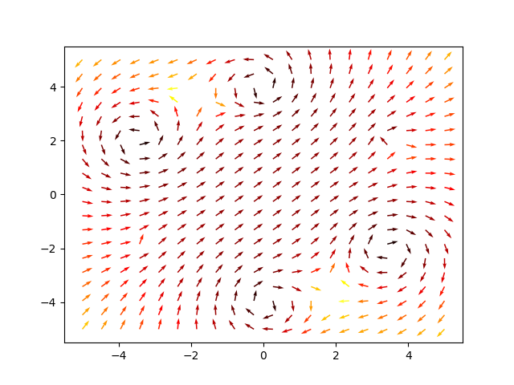

# Rotating Magnetic Field of a Stator

Animates the magnetic field produced by a three-phase stator: `p` pairs of wires are placed on a circle and each carries a sinusoidal current shifted by `2*pi/p`, so the superposition of the Biot-Savart fields of the single wires is a field vector that rotates in time. The script draws the normalised field on a grid with `matplotlib.quiver`, coloured by magnitude, and advances the phase on every frame.

## How to run
Python 3 with `numpy`, `matplotlib`, `keyboard`. `python vectors.py`; change `p` at the top of the file for a different number of phases. The `Figure_*.png` files are frames of the animation.

